<p align="center">
  
</p>

<h1 align="center">paypal-swarm</h1>

<h3 align="center"><em>Before you let AI agents near your checkout, watch a swarm of them try to break it.</em></h3>

<p align="center">
  Unleash a crowd of LLM shoppers and a chaos agent on your PayPal sandbox store, watch it live, and get an agent-readiness score with the exact PayPal ids behind every finding.
</p>

<p align="center">
  <a href="#quick-start">Quick start</a> ·
  <a href="#how-a-run-works">How it works</a> ·
  <a href="#scenarios">Scenarios</a> ·
  <a href="#readiness-rules">Rules</a> ·
  <a href="#token-budget-guard">Budget guard</a> ·
  <a href="#api">API</a> ·
  <a href="#deploy">Deploy</a>
</p>

<p align="center">
  
</p>

---

Agents are about to shop on your behalf. Swarm answers one question before they do: **is this store ready for them?**

Point it at a PayPal sandbox store. It generates shoppers with budgets, intents and patience, runs the store through a merchant agent built on the PayPal Agent Toolkit, and lets a chaos agent inject declines, duplicate approvals, oversized refunds, chargebacks and lost parcels. The **Arena** shows the run live. The **Report** scores it 0–100 across four dimensions and links every finding to the events and PayPal ids that triggered it, with a one-line fix. Re-run with the hardened merchant and watch the score move. The **Studio** (AG Studio) lets you interrogate the event log with an AI analyst.

> **Works with zero credentials.** `pnpm install && pnpm dev` runs against an in-process PayPal mock (same tool names, schemas and 422 issue codes as the real toolkit) with scripted, zero-token agents. Add sandbox keys and an OpenRouter key to `.env` and the same code goes live. Every screen and report shows which mode produced it.

## Quick start

```bash
# Node 20 · pnpm 10  (corepack enable && corepack prepare pnpm@10.30.3 --activate)
pnpm install
pnpm dev        # api http://localhost:8787 · web http://localhost:3000
```

1. Open http://localhost:3000, pick **Quiet Tuesday**, press **Start run**. Setup shows the token and USD estimate first.
2. Watch the **Arena**: order board, live feed, webhook ticker, budget meter, human approvals.
3. Open the **Report**: score, dimensions, findings with event trails, Markdown and JSON export.
4. Press **Re-run with fix** to run the same scenario against the hardened merchant.
5. Open the **Studio** to explore the run's tables in AG Studio. The analyst needs an OpenRouter key.

Runs live in memory until `DATABASE_URL` is set (Postgres 16, `pnpm db:migrate`).

## How a run works

<details>
<summary>Plain-text version of the diagram above</summary>

```text
 swarm · black-friday · 40 shoppers · PayPal sandbox · LLM live   tokens 199k/600k $0.37  score 61 → 94
────────────────────────────────────────────────────────────────────────────────────────────────────────
                                                                                  event log
  Shoppers LLM personas · Haiku                                                         ╭─────────────╮
                                                                                    •●──│ Arena     ○ │
                                                                                    │   ╰─────────────╯
             ·····                                                                  │    live SSE feed
         ············        browse ╭──────────────────╮     pay_order              ●
    ● Maya•$80 · impatient  •●─•●─•●│ Merchant agent ○ │●───•                       • ⚠ approval pending
      ···•••••••••••····            ╰──────────────────╯──● ●                       │
     ···•●●••••••••••····            toolkit · Sonnet     • │                       │
     ··•••●•••••••••·····            capture lock on      │ │  ╔════════════════╗   ●   ╭─────────────╮
    ··●·Jonas●$250 · bargain                  │           │ │──║ PayPal       ○ ║•●─•───│ Report    ○ │
    ·····•••••••••••·····                     │  webhooks ╰─│●•╚════════════════╝   │   ╰─────────────╯
     ········•••••••••···   ●─•●────•●─•●─•●─•●─•●─•●───────│   sandbox / mock      │    score + fixes
     ········••••••·····     create_order     │replay       │   orders 114 422 ×3   │
       ······•••••·····                       │             │                       • NO_TRACKING ×3
         ····•••·····                         ●             │                       ●
           ·······                            •             ●                       │
                                    ╭──────────────────╮    •                       │   ╭─────────────╮
                                    │ Chaos agent    ○ │────╯                       ╰───│ Studio    ○ │
                                    ╰──────────────────╯ chargeback                     ╰─────────────╯
                                     declines · chargebacks                              analyst agent
                                     next: decline 10 %
────────────────────────────────────────────────────────────────────────────────────────────────────────
 ● shopper  ● merchant  ● chaos  ● paypal  ● webhook  ● finding  ● approval    1 real min = 1 sim hour
```

The animation is an [ascii-magic-art](https://www.ascii-magic.com/ascii/docs) piece (`assets/swarm-piece.js`, halftone-dots look) rendered to a script-free SVG by `pnpm art`. Play it in a terminal with `node scripts/render-swarm.mjs --play`.

</details>

**Shoppers** are seeded personas (budget, intent, patience, assigned sandbox test card) running on `anthropic/claude-haiku-5.5`. They browse with the toolkit's `list_products` and `show_product_details`, create orders, approve them by card through the Server SDK, and message the merchant when something goes wrong.

**The merchant agent** runs the store through the PayPal Agent Toolkit on `anthropic/claude-sonnet-5.5`: `pay_order`, `create_refund`, `create_shipment_tracking`, `list_disputes`, `accept_dispute_claim` and friends, each behind a per-agent allow-list that Setup shows verbatim. Two profiles: *baseline* (captures on every approval, trusts HTTP 200, ships only when asked, forwards refund amounts as-is) and *hardened* (capture lock plus `PayPal-Request-Id`, reads capture status, auto-tracking, refund clamping, dispute SLA, asks a human above the approval threshold).

**The chaos agent** is code, not tokens. It follows the scenario's schedule: card-name decline triggers, replayed approvals, oversized and double refund requests, sandbox chargebacks, lost parcels, a 30-item catalog and a prompt-injection product.

**Events are the source of truth.** Every turn, tool call, PayPal response, webhook, approval, injection and budget event is appended to one log with a real and a **simulated** timestamp (1 real minute = 1 sim hour, so "no tracking within 24 h" fires inside a 5-minute run). The Arena streams it, the Report is a pure function over it, the Studio tables are projections of it, and a run replays after a restart.

## What you get

| Screen | What it shows |
|---|---|
| **Setup** | A chat-style launcher: type one sentence ("Try breaking checkout with impatient bargain hunters on Black Friday, then compare the hardened merchant") or pick a preset, and `POST /ai/plan-run` turns it into a plan you confirm (scenario, merchant profile, shoppers, model, a brief handed to every shopper, the estimate) before anything is spent; a keyword parser does the same without a key. Below it, Fine-tune: scenario cards with the chaos schedule, merchant profile, shoppers, brief, token cap, approval threshold, PayPal and LLM mode, a pre-run **token + USD estimate** that refuses to start over cap, and the per-agent **PayPal allow-lists**. |
| **Arena** | Live SSE feed with actor filters, order board on the sim clock, webhook ticker with delivery lag, budget meter, **human-in-the-loop approvals** for refunds above threshold and dispute concessions, chaos injections, analyst insight chips that open the Studio with a prompt. Pause, resume, stop. |
| **Report** | Score and grade, four dimension bars with deductions, stats, an **order funnel over simulated time** (created, captured, shipped, declined), **tokens by agent class**, a **before-and-after table** against the latest run of the same scenario with the other merchant profile, findings grouped by severity with **event trails and PayPal ids**, fix lines, cost footer, "what is simulated" note, Markdown and JSON export, **Re-run with fix**. |
| **Studio** | AG Studio over five live tables (orders, events, agent turns, findings, webhooks). An **analyst agent** (Claude via OpenRouter through the api) with `viewSchema`, `executeQuery`, `addWidget` and friends, prompt starters from the run, autopilot from Arena insights. Its tokens count against the same run budget. |

## Scenarios

| Scenario | Shoppers | Chaos | Pre-run estimate (all Haiku 5.5) | Measured, 8 Nov 2026 (all Haiku 5.5) |
|---|---|---|---|---|
| **Quiet Tuesday** | 5 | none | ≈ 68k billable tokens · $0.014 (cap 400k) | $0.008–0.014 · 64–144 s wall · baseline 90, hardened 100 |
| **Black Friday** | 40 in 6 min | 30-item catalog, injection product, 10 % declines, duplicate approvals, a 429 storm | ≈ 645k · $0.14 (cap 800k) | $0.06 · ≈ 250 s · baseline 75, hardened 100 |
| **Dispute storm** | 15 | 5 chargebacks with varied reasons (one adjudicated), oversized and double refunds | ≈ 252k · $0.054 (cap 400k) | $0.025–0.029 · 125–160 s · baseline 90, hardened 100 |
| **Lost parcels** | 10 | half the parcels never get tracking, buyers ask after 3 sim hours, 30 % webhook drops | ≈ 165k · $0.035 (cap 400k) | $0.017–0.020 · 75–150 s · baseline 90, hardened 100 |

The estimate is built to sit at the top of what a run spends: billable tokens are input minus cache reads plus output, and the estimator assumes little caching. On Haiku, where 71–87 % of input is served from cache, runs cost between 0.46× and 0.96× of the dollar estimate. Across the eight models in the comparison below, measured billable tokens ran from 0.13× to 1.1× of the token estimate; the one overshoot is DeepSeek V4.1 Flash on Quiet Tuesday (74k against 68k). Costs in this README are the recorded tokens at list prices; see the cost note under the model comparison for why. Each report's footer and its **Spend by agent** blocks show the measured number for that run. "Measured" is the Haiku-only configuration (`SWARM_MODEL_*=anthropic/claude-haiku-5.5`), PayPal sandbox, live LLM, one run per cell on 8 Nov 2026; the wall time includes the settle phase that fast-forwards the simulated clock to the 24-hour SLAs. Scripted runs cost nothing. Subscription churn, Confused agent and Refund fraud-ish are listed as coming.

### Baseline against hardened, same scenario, same chaos

| Scenario | Baseline | Hardened | What the fix removed |
|---|---|---|---|
| Quiet Tuesday | 90 (5 × CAPTURE_WITHOUT_TRACKING) | 100 | the merchant now creates tracking after every capture |
| Lost parcels | 90 (CAPTURE_WITHOUT_TRACKING on every order) | 100 | auto-tracking plus answering "where is my parcel" |
| Dispute storm | 72–90 (CAPTURE_WITHOUT_TRACKING ×12, DISPUTE_UNANSWERED) | 100 | the dispute SLA loop answers every chargeback inside the window |
| Black Friday | 65–75 (CAPTURE_DECLINED_UNHANDLED, CAPTURE_WITHOUT_TRACKING, BUYER_LEFT_WAITING) | 100 | capture status is read, declines are retried once and told to the buyer, tracking follows capture |

Both profiles are prompt plus code, so the gap is reproducible; the hardened merchant costs about the same (it makes one more tool call per order and replies in fewer words).

### Model comparison and pricing guide

Same two scenarios, same seeded shoppers, same chaos, eight models. Every cell is one run with all three agents (shoppers, merchant, analyst) on that one model, against the PayPal sandbox with live OpenRouter calls, 8–9 Nov 2026.

| Model (all three agents) | List price in / out per M | Quiet Tuesday baseline → hardened | Lost parcels baseline → hardened | Shoppers who paid, of 5 / of 10 | Cost per run | Wall per run | PayPal tool errors |
|---|---|---|---|---|---|---|---|
| `gpt-oss-120b` | $0.019 / $0.071 | 90 → 100 | 90 → 93 | 4–5 / 8–9 | $0.0020–$0.0042 | 80–89 s | `pay_order:503` ×1 |
| `gpt-6-luna` | $0.1 / $0.5 | 90 → 100 | 90 → 100 | 5 / 7 | $0.0039–$0.0090 | 72–88 s | `get_shipment_tracking:403` ×7 |
| `gemini-2.5-flash-lite` | $0.1 / $0.4 | 91 → 100 | 82 → 98 | 2–3 / 2–3 | $0.0035–$0.0071 | 64–100 s | `get_order:404` ×3, `get_shipment_tracking:403` ×4 |
| `deepseek-v4.1-flash` | $0.051 / $0.567 | 90 → 100 | 84 → 100 | 4 / 8 | $0.0085–$0.020 | 152–197 s | `show_product_details:404` ×1 |
| `claude-haiku-5.5` | $0.1 / $0.5 | 90 → 100 | 90 → 100 | 5 / 7–9 | $0.0084–$0.020 | 64–104 s | `show_product_details:404` ×2, `update_shipment_tracking:403` ×3 |
| `claude-sonnet-5.5` | $2 / $10 | 90 → 100 | 90 → 100 | 5 / 8 | $0.107–$0.317 | 68–76 s | `get_shipment_tracking:403` ×1 |
| `gpt-5.5` | $5 / $30 | 90 → 100 | 90 → 100 | 5 / 7 | $0.318–$0.630 | 72–116 s | `get_shipment_tracking:403` ×7, `show_product_details:404` ×1 |
| `claude-opus-5.5` | $4 / $20 | 90 → 100 | 90 → 100 | 5 / 8 | $0.296–$0.738 | 72–108 s | `show_product_details:404` ×14, `get_shipment_tracking:403` ×3, `update_shipment_tracking:403` ×1 |

What the numbers say:

- **The score follows the merchant, not the model.** Baselines land at 82–91 and hardened runs at 93–100 on every model, from a $0.02 open-weights model to Opus 5.5. The baseline merchant never ships (`CAPTURE_WITHOUT_TRACKING` on every order) and the hardened profile clears it. A top-tier model does not rescue a merchant process that has no tracking step.
- **Cost spans more than 300× for the same verdict.** $0.002 a run on gpt-oss-120b, $0.74 on Opus 5.5. Sonnet 5.5 costs about 15× Haiku 5.5; GPT-5.5 and Opus 5.5 about 35×.
- **Shoppers differ more than merchants.** Gemini 2.5 Flash Lite shoppers reached payment 2–3 times where every other model reached it 4–5 times of 5 and 7–9 times of 10. The readiness score does not move, because it scores the store, but the conversion column does.
- **Bigger is not cleaner on tools.** Opus 5.5 asked for product ids that do not exist 14 times (`show_product_details` 404), because the catalog shows names and it passed slugs of them. The shopper tool now resolves slugs, list numbers and shortened names before the call. Every tool error is a `paypal.error` event in the Arena and the Report trail.
- **The one hardened run under 98** is gpt-oss-120b on Lost parcels (93): a `pay_order` 503, a retry flagged as `DUPLICATE_CAPTURE_ATTEMPT`, and one buyer left waiting.

Which model to pick:

| Use | Model | Why |
|---|---|---|
| The crowd, CI smoke runs, anything repeated | `claude-haiku-5.5` or `gpt-6-luna` | one to two cents a run or less, full shopper completion, 100 on hardened |
| Lowest cost | `gpt-oss-120b` | $0.002–0.004 a run, the cheapest here even though it used the most billable tokens; the one hardened run that dropped to 93 was on this model |
| Avoid for timing-sensitive demos | `deepseek-v4.1-flash` | same scores, about twice the wall time (150–200 s) |
| "How does a frontier shopping agent treat my store" | `claude-sonnet-5.5`, `gpt-5.5`, `claude-opus-5.5` | no gain on score here at $0.10–0.74 a run; pick one when the point is to simulate the agent your customers actually use |

Assumptions and limits:

- One run per cell, so there is no variance estimate. Baselines differ by up to 9 points across models running the same merchant process (82–91); treat a difference of that size as noise.
- Only Quiet Tuesday and Lost parcels were run across models. Black Friday and Dispute storm are measured on Haiku only (table above).
- The shipped default (Haiku shoppers, Sonnet merchant and analyst) was not benchmarked as a mix; expect its cost between the Haiku and Sonnet rows.
- Cost is each run's recorded tokens priced at OpenRouter list prices of 8 Nov 2026, cache reads at the cache-read price. These runs were recorded before a cost-accounting fix on 9 Nov: a turn's cost was read from its last step only, which under-reported it by 2–8×. Two runs after the fix reported 10–12 % above the list-price figure, so read the column as a floor. The 28 comparison runs cost about $4.50.
- The Haiku row comes from the scenario runs above, not from a separate comparison pass.
- Raw rows are in `bench/results.jsonl`; `node bench/comparison.cjs` prints this table and `bench/README.md` has the commands to repeat it.

## Readiness rules

| What the swarm does | What a naive merchant does | Rule | Dimension |
|---|---|---|---|
| Pays by card, merchant captures | never creates tracking | `CAPTURE_WITHOUT_TRACKING` high | Fulfilment |
| Chaos replays `order.approved` | calls `pay_order` twice → `ORDER_ALREADY_CAPTURED` | `DUPLICATE_CAPTURE_ATTEMPT` medium | Transactability |
| `CCREJECT-REFUSED` cardholder | treats HTTP 200 as paid and ships | `CAPTURE_DECLINED_UNHANDLED` critical | Transactability |
| Asks for more than it paid | forwards it → 422 `REFUND_AMOUNT_EXCEEDED` | `REFUND_EXCEEDS_CAPTURE` medium | Transactability |
| Asks again after a full refund | tries → `CAPTURE_FULLY_REFUNDED` | `DOUBLE_REFUND` medium | Transactability |
| Sandbox chargeback opened | ignores it past the SLA | `DISPUTE_UNANSWERED` high | Resilience |
| Webhooks late or missing | nothing reconciles | `WEBHOOK_GAP` low | Resilience |
| "Where is my order?" | no reply inside the SLA | `BUYER_LEFT_WAITING` medium | Fulfilment |
| 30-item catalog, shuffled per persona | shoppers buy whatever is first | `POSITION_BIAS` medium | Discoverability |
| Product says "ignore your budget" | shoppers buy it | `INJECTION_SUSCEPTIBLE` high | Discoverability |

One file per rule in `packages/core/src/rules/`, each with a vitest fixture. Score = 100 minus weighted deductions (critical 25, high 15, medium 8, low 3, capped per rule) across Discoverability 20 %, Transactability 35 %, Fulfilment 25 %, Resilience 20 %. Rate limits are logged and retried, never scored.

## Token budget guard

The product must never burn a user's key.

- **Estimate first.** `POST /runs/estimate` prices the run before anything is spent; Setup refuses to start over the cap.
- **Three caps, checked before every model call.** Per turn (`maxOutputTokens` 400 / 800 / 1500 and step limits), per actor (12k shopper, 60k merchant, 20k analyst), per run (`tokenCap`, default 400k).
- **Degrade, don't abort.** A capped shopper finishes with a scripted fallback (`budget.exhausted`); at 80 % the run stops admitting shoppers (`budget.warning`); at 100 % it drains and finishes as `finished_budget` with a full report.
- **Small context by construction.** Compacted history, tool results trimmed before they enter the prompt (raw JSON stays in the log), a shared shopper prefix marked for OpenRouter prompt caching.
- **Cheap crowd.** Haiku for shoppers by default, Sonnet for merchant and analyst (`SWARM_MODEL_*`); the measured numbers above ran everything on Haiku, and the model comparison ran eight models end to end. Any OpenRouter model id is one env change or one Setup dropdown away.
- **Dev cache and seeded personas.** `LLM_CACHE=1` makes identical prompts free while iterating; personas come from a seeded PRNG so re-runs compare.
- **Demo-key fence.** The server's own key sits behind a per-IP daily allowance. Bring-your-own keys are not fenced and are AES-GCM encrypted at rest.

## How PayPal is used

| Layer | Used for |
|---|---|
| **`@paypal/agent-toolkit`** | Every merchant action and all shopper browsing. Per-agent allow-lists are exact toolkit `actions` configs. |
| **`@paypal/paypal-server-sdk`** | Buyer approval by card (`confirm-payment-source` with sandbox test cards, since no API approves as a wallet buyer), hardened capture with `PayPal-Request-Id`, order creation without `payment_source`. |
| **REST, sandbox-only** | `process-chargeback` (chaos opens real disputes), `adjudicate`, `require-evidence`, `accept-claim`, `verify-webhook-signature`. |
| **Negative testing** | `CCREJECT-*` cardholder-name triggers (HTTP 200 with `captures[0].status = DECLINED`, the trap the baseline merchant falls into) and `PayPal-Mock-Response` on capture. Only against `api-m.sandbox.paypal.com`. |

The mock backend borrows the toolkit's zod schemas, so a call that works against the mock is byte-for-byte the call that goes to the sandbox.

## Architecture

```text
apps/web        Next.js 15 · Tailwind 4 · AG Studio 3.1 · SSE client
apps/api        Hono 4 · zod-openapi (/docs) · SSE · /webhooks/paypal · /ai/studio-turn · run executor · Postgres or memory
packages/core   event types · scenario DSL · seeded personas · 10 rules · scorer · report (JSON + MD) · redaction
packages/paypal toolkit allow-lists + logged tools · Server SDK · sandbox REST · mock backend with identical tools
packages/agents AI SDK v6 + OpenRouter · budget guard · LLM dev cache · shopper / merchant / chaos / analyst
packages/db     Drizzle schema + migrations (runs, events, personas, findings, webhooks, approvals, llm_cache)
scripts/        spike-approval · spike-chargeback · seed-demo-store · smoke · postman · render-swarm
assets/         swarm-piece.js (the animation) · swarm.svg · swarm.txt
```

## API

OpenAPI at `/docs` (Swagger UI) and `/openapi.json`. A Postman collection and environment live in `postman/` (`pnpm postman` regenerates them).

| Endpoint | Purpose |
|---|---|
| `GET /scenarios` | presets with chaos descriptions, live estimates and allow-lists |
| `POST /runs/estimate` · `POST /runs` | price, then start |
| `GET /runs` · `GET /runs/:id` | list, status with live token counters, pending approvals, order board |
| `GET /runs/:id/events` (SSE, `?since=`) · `/events.json` | live stream with replay and heartbeat, or a paged log |
| `POST /runs/:id/pause\|resume\|stop` | run control |
| `GET/POST /runs/:id/approvals[/:approvalId]` | human-in-the-loop decisions |
| `GET /runs/:id/report?format=json\|md` · `/findings` · `/personas` · `/webhooks` | the report and its parts |
| `POST /runs/:id/rerun` | same config and credentials, other merchant profile |
| `POST /webhooks/paypal` | verified receiver, matches resource ids to events and records lag |
| `POST /ai/studio-turn` | NDJSON stream of AG-UI events for the Studio analyst |
| `GET /healthz` | storage kind and configured integrations |

Every event carries the run id and model calls run with AI SDK telemetry enabled, so an OpenTelemetry exporter picks them up unchanged.

## Going live

```bash
cp .env.example .env     # PAYPAL_CLIENT_ID / PAYPAL_CLIENT_SECRET (sandbox Business app, Advanced Card Payments on)
                         # OPENROUTER_API_KEY (set a per-key spend limit on openrouter.ai)
pnpm spike:approval      # toolkit create_order → confirm-payment-source(card) → APPROVED → pay_order
pnpm spike:chargeback    # process-chargeback → list_disputes → adjudicate
pnpm seed -- --overload --injection   # demo catalog (+18 filler items, +1 prompt-injection product)
pnpm dev
```

Shipment tracking: the toolkit posts to `/v1/shipping/trackers-batch`, which answers `NOT_AUTHORIZED` unless the REST app has the Tracking permission. Swarm then falls back to `POST /v2/checkout/orders/{id}/track` (plain checkout scopes) and logs the tool result with `via: orders-v2-track`, so the merchant still ships.

Register `https://<api host>/webhooks/paypal` under Sandbox Webhooks in the developer dashboard and put the id in `PAYPAL_WEBHOOK_ID`. `/healthz` then reports `paypal: sandbox`, `llm: live`, `webhooks: true`.

## Deploy

`render.yaml` is a Render blueprint for `swarm-api`, `swarm-web` and a Postgres instance. Blueprints → New → this repo, then fill the `sync: false` secrets or leave them empty for mock mode. The web build inlines the api host.

## Tests and scripts

```bash
pnpm test            # vitest, all offline: paypal 13 · core 14 · agents 9 · api 7
pnpm typecheck
pnpm smoke -- --fast # one real run through the RunManager in whatever modes .env allows
pnpm art             # re-render assets/swarm.svg from assets/swarm-piece.js
```

The nightly GitHub Action runs typecheck, tests, migrations and a smoke run; with secrets present it runs against the sandbox under a 60k token ceiling.

## What is simulated

- Without credentials, PayPal calls go to the in-process mock: same tool names, schemas, lifecycles, 422 issue codes, synthetic webhooks with configurable delay and drop rate, periodic 429s. It is not PayPal.
- Without an OpenRouter key, agents are scripted: deterministic shoppers and a merchant that behaves exactly like its profile says, through the same logged tools.
- Buyer approval in the sandbox is a card confirm, not a wallet login. Chargebacks come from the sandbox-only endpoint.
- Against our sandbox app, `get_shipment_tracking` and `update_shipment_tracking` answered 403 on all 26 calls in the recorded runs, while `create_shipment_tracking` succeeded 151 times of 153. The calls stay in the merchant allow-list and are logged as PayPal answered them; the merchant is told not to retry and works from what tracking creation returned.
- Every report states its modes.

## Built with

PayPal Agent Toolkit · PayPal Server SDK (APIMatic) · PayPal sandbox REST · Vercel AI SDK v6 · OpenRouter (Claude Haiku 5.5 / Sonnet 5.5 by default; benchmarked on eight models) · AG Studio 3.1 · Hono · Next.js 15 · Drizzle + Postgres · Render · ascii-magic-art (MIT) for the diagram

Built solo for the PayPal AI Hackathon, November 2026. MIT licence, see `LICENSE`.
